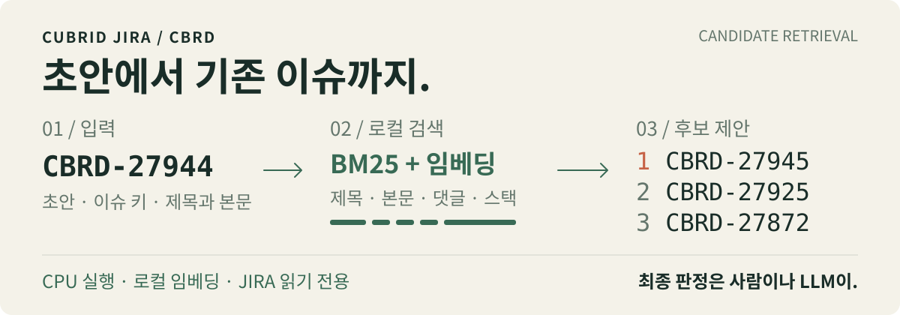

# CBRD 중복 이슈 검사기

새 이슈를 등록하기 전에, 이미 등록된 CUBRID JIRA 이슈에서 중복·관련 후보를 찾는다.
`cubrid-jira-dup candidate-find`는 후보를 순위대로 제안하고, 최종 판정은 출력을 읽는 사람이나 LLM이 맡는다.

<p>
  <picture>
    <source media="(max-width: 600px)" srcset="./assets/readme/workflow-mobile.svg">
    
  </picture>
</p>

[후보 찾기](#후보-찾기) · [평가 결과](#평가-결과) · [검색 방식](#검색-방식) · [상세 사용법](docs/usage.md)

## 검색 결과 예시

```bash
cubrid-jira-dup candidate-find CBRD-27944 --no-sync -k 3
```

로컬 인덱스에서 실행한 결과의 후보와 공통 식별자를 발췌했다. 이 순위는 중복 판정을 뜻하지 않는다.

| 순위 | 후보 | 질의와 공통인 식별자 일부 |
| --- | --- | --- |
| 1 | [CBRD-27945](https://jira.cubrid.org/browse/CBRD-27945) | `oos_file.cpp` |
| 2 | [CBRD-27925](https://jira.cubrid.org/browse/CBRD-27925) | `pending_deletes`, `oos_file.cpp` |
| 3 | [CBRD-27872](https://jira.cubrid.org/browse/CBRD-27872) | `pending_deletes`, `swept_this_boot` |

실제 출력에는 제목, URL, 유형, 상태, resolution, 생성 시각과 검색 신호도 포함된다. 기본 후보는 20개이며 `-k`로 1~50개를 요청한다. `--json`은 같은 결과를 JSON 문서 하나로 출력한다.

## 평가 결과

recall@10은 정답으로 연결된 이슈가 상위 10개 후보에 드는 비율이다. 중복 판정의 정확도를 뜻하지 않는다.

| 구간 | 정답 쌍 | recall@10 | recall@20 |
| --- | ---: | ---: | ---: |
| 평가용(test) 전체 | 103 | **0.825** | 0.835 |
| 평가용 중 2026년 생성 질의 | 35 | **0.800** | 0.829 |
| 조정용(dev)까지 합친 전체 | 202 | 0.782 | 0.812 |

2026-11-09 고정 스냅샷의 결과다. 이슈 키와 이슈 번호를 담은 식별자를 가리고, 질의보다 먼저 생성된 이슈만 검색했다.
평가용 두 구간은 기준인 0.8 이상을 충족한다. 다만 2026년 구간은 35쌍 중 28쌍으로 기준에 걸려 있다. 조정용까지 합치면 0.8에 못 미친다.

구현 단계에서 평가용 결과를 본 뒤 내린 결정도 있어, 완전히 독립적인 최종 평가로 보기는 어렵다. [비교 조건·방식 선택·한계](docs/candidate-search.md)와 [전체 평가 표](docs/usage.md#검색-방식)를 함께 참고한다.

## 후보 찾기

Python 3.12 이상, [uv](https://docs.astral.sh/uv/), [just](https://github.com/casey/just)가 필요하다.

```bash
git clone https://github.com/vimkim/cubrid-jira-duplicate.git
cd cubrid-jira-duplicate
just install
cubrid-jira-dup candidate-find CBRD-27944
```

`just install`은 `uv tool install --reinstall .`로 CLI를 설치한다. 첫 검색은 공개 CBRD 이슈 전체를 받아 로컬 인덱스를 만들고, 약 470 MB의 임베딩 모델을 내려받는다. 개발 서버의 기존 측정에서는 모델 다운로드를 제외하고 13분 31초가 걸렸다. 이후에는 바뀐 이슈와 글만 갱신한다. [첫 실행의 측정 조건](docs/usage.md#첫-실행)을 확인한다.

### 초안이나 제목으로 검색

초안 파일은 첫 번째 `# ` 줄을 제목으로, 나머지를 본문으로 쓴다.

```bash
cubrid-jira-dup candidate-find draft.md
cubrid-jira-dup candidate-find --title "loaddb가 느리다" < body.txt
cubrid-jira-dup candidate-find draft.md --json > candidates.json
```

`draft.md`나 `body.txt`는 검색할 이슈 내용으로 준비한다. 파일, 이슈 키, `--title` 중 한 가지 입력만 준다. 기존 이슈 키로 검색하면 그 이슈 자신은 후보에서 뺀다.

### 결과를 읽을 때

- 후보의 URL과 제목, 검색 신호를 읽고 중복·관련 여부를 판단한다. 후보가 0개여도 중복이 없다고 보장하지 않는다.
- 종료 코드 `0`은 요청한 검색이 완료되었다는 뜻이다. `2`는 입력·인덱스·임베딩 오류나 불완전한 동기화를 뜻한다. 동기화 오류가 있어도 기존 인덱스로 찾은 후보가 나올 수 있다.
- `--no-sync`는 JIRA 동기화를 건너뛴다. 인덱스를 미리 만들거나 갱신하려면 `cubrid-jira-dup sync`를 실행한다.

[입력 한도·JSON 스키마·종료 코드](docs/usage.md#입력-세-가지), [인덱스 위치](docs/usage.md#인덱스와-모델-위치), [스레드 설정](docs/usage.md#스레드)은 상세 사용법에 있다.

## 검색 방식

SQLite 인덱스 하나에 이슈 본문, 댓글, 제목과 벡터를 저장한다. GPU나 별도 검색 서버 없이 CPU에서 다섯 검색 순위를 결합한다.

| 채널 | 찾는 단서 | 가중치 |
| --- | --- | ---: |
| Lexical | 질의 텍스트와 본문·댓글의 BM25 | 2 |
| Semantic | 질의 텍스트와 본문·댓글의 다국어 임베딩 유사도 | 1 |
| Title | 제목끼리의 BM25 | 1 |
| Title semantic | 제목끼리의 다국어 임베딩 유사도 | 1 |
| Stack | 콜 스택 상위 함수 두 개의 BM25 | 4 |

채널별 상위 200개를 가중 RRF로 합친 뒤, 생성 시각이 가까운 이슈에 작은 가산점을 더한다. 임베딩 모델은 `intfloat/multilingual-e5-small`이다. [점수식·시간 기준·평가 재실행](docs/usage.md#검색-방식)은 상세 사용법에 있다.

일반 검색은 질의보다 나중에 생성된 이슈도 후보로 낸다. 이슈 키 입력의 생성 시각은 근접도 점수의 기준으로 쓴다. 평가에서는 질의 이전의 이슈와 댓글만 비교한다.

## 현재 한계

- 두 제목 중 한쪽에만 한글이 있는 32쌍의 recall@10은 0.469다. 임베딩 입력은 앞 4,000자로 자르고, 모델은 최대 512 토큰을 처리한다.
- 증분 동기화는 비공개로 전환된 이슈를 알아채지 못한다. `sync --full`은 전체를 다시 받아 더 이상 보이지 않는 이슈를 제거한다.
- 등록된 이슈를 일괄로 훑는 사후 검사와 이슈 작성 스킬 연동은 아직 구현하지 않았다.

이 도구는 공개 JIRA를 익명으로 읽는다. JIRA에 링크·댓글·라벨을 쓰거나 등록을 막지 않으며, 초안을 외부 추론 서비스로 보내지 않는다. 임베딩은 로컬에서 계산한다.

## 문서와 개발

| 문서 | 내용 |
| --- | --- |
| [상세 사용법](docs/usage.md) | 입력·옵션, 인덱스, 성능 측정 기록, 평가·근거 재계산 명령 |
| [요구사항](docs/requirements.md) | 지원 범위, 평가 방법, 합격 기준과 결정 기록 |
| [근거 측정](docs/evidence.md) | 정답 쌍, JQL 기준선, 이슈 생성 시각·언어·생성량 |
| [후보 검색 방식 비교](docs/candidate-search.md) | 검색 엔진·리랭커 비교와 선택 이유, recall의 한계 |
| [요구사항 리뷰](docs/reviews/requirements-review.md) | 독립 리뷰 17건과 근거 |

```bash
just setup   # 개발 환경 준비
just check   # ruff와 pytest. 네트워크나 모델 다운로드 없이 실행
```

코드는 `src/cbrd_dup/`에 있다. [모듈 구성과 공개 데이터](docs/usage.md#개발)는 상세 사용법에 정리했다. 관련 이슈는 [CBRD-27978](https://jira.cubrid.org/browse/CBRD-27978)이다.

[이슈 작성 브리프](docs/issue-brief.md)와 `docs/briefs/`, `docs/reviews/`, `docs/jira/`의 날짜별 기록은 당시의 `scripts/` 경로를 그대로 인용한다.
